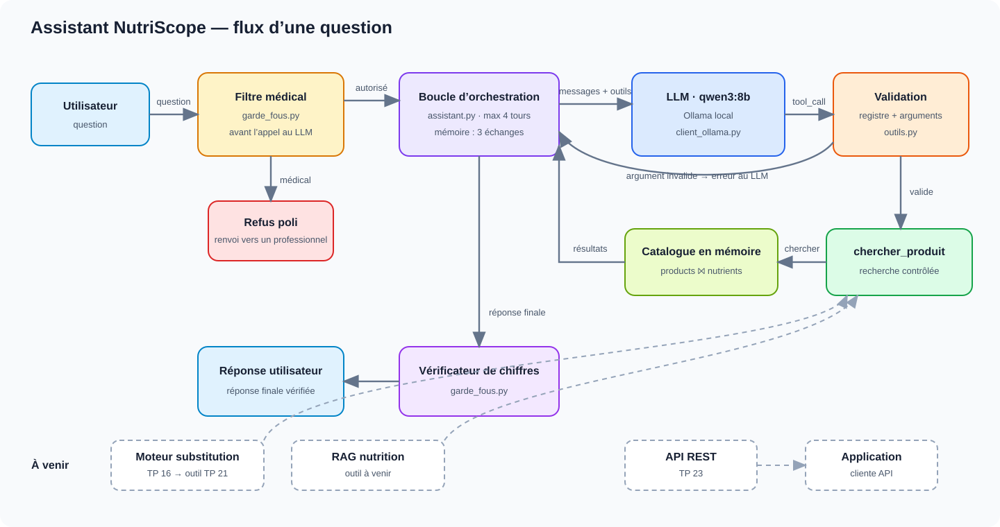

# Architecture de l'assistant NutriScope (TP 18)

## Composants

| Composant | Rôle | État |
|---|---|---|
| `catalogue.py` | Charge `products` ⨝ `nutrients` une seule fois (≈ 6 s, 1,25 M produits), précalcule le nom normalisé, construit les fiches du contrat (NaN → `null`, jamais 0). | branché |
| `outils.py` | Contrat `chercher_produit` : validation stricte des arguments, recherche (code prioritaire, sinon nom sans casse ni accents), statut `ok` / `ambigu` / `introuvable`. Registre fermé `OUTILS` : un nom d'outil inconnu donne une erreur, jamais d'`eval`. | branché |
| `client_ollama.py`, `client_openrouter.py` | Adaptateurs du même protocole `discuter(messages, outils)`. Ollama reste le choix par défaut ; OpenRouter sert à la comparaison dans le notebook et demande une clé en variable d'environnement. | branchés |
| `assistant.py` | Boucle : envoie la question, exécute les outils demandés, renvoie les résultats, s'arrête à la réponse finale ou au bout de **4 tours** (pas de boucle infinie). **Mémoire de conversation** : reçoit et renvoie l'historique, sans état interne ; fenêtre glissante de 3 échanges complets (coût en tokens et latence bornés). Produit une trace complète (appels, résultats, latence). | branché |
| `garde_fous.py` | Filtre médical, prompt système, vérificateur de chiffres. | branché |
| Substitution, RAG, API, application | Nouveaux outils dans le registre (TP 21), exposition HTTP (TP 23). | à venir |

## Où sont les garde-fous, et pourquoi là

1. **Conseil médical : filtre déterministe *avant* le LLM.** Le risque est le plus élevé, et un mot-clé (« diabétique », « traitement »…) suffit à le détecter. Le refus est garanti, testable et ne coûte aucun appel. Limite : faux négatifs sur des formulations détournées. Le prompt système sert alors de seconde ligne.
2. **Hors alimentation : prompt système.** La liste des sujets hors périmètre est infinie, impossible à énumérer par mots-clés. On fait confiance au modèle, avec un risque assumé.
3. **Arguments d'outil : validation dans notre code.** Ce que le modèle écrit est traité comme une donnée non fiable.
4. **Valeurs inventées : vérificateur après le LLM.** Chaque nombre de la réponse doit se retrouver dans un résultat d'outil, sinon il est signalé. Il ne détecte pas les contresens (« 0 » pour une valeur absente).

## Limites connues

- Les kcal de certaines fiches ont été **recalculées** par la formule 4/4/9 au nettoyage (`src/cleaning.py`, `corriger_energie`), sans drapeau permettant de les distinguer d'une valeur d'étiquette.
- `ambigu` sur un nom générique (« Nutella » : 396 résultats) : le modèle choisit la première fiche. Le tri (nom exact, puis complétude) rend ce choix raisonnable, mais pas garanti.

*Données : Open Food Facts, licence ODbL.*
