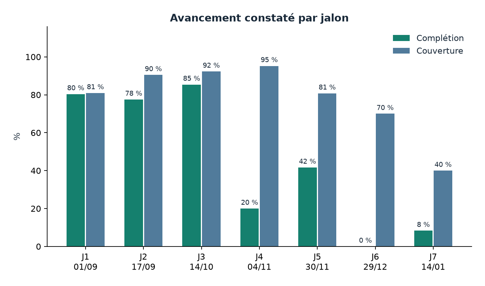
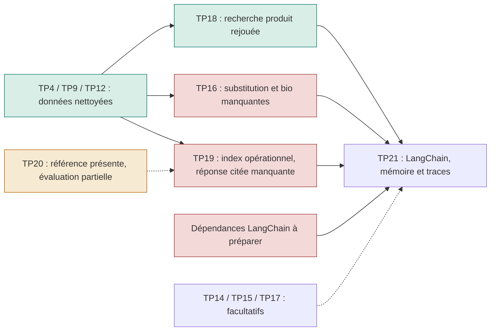

# Audit technique et pédagogique de NutriScope

23 novembre 2026 · périmètre local, dépôt d’équipe et fork.

## Résumé exécutif

**GO CONDITIONNEL pour démarrer le TP21.** La recherche produit a été rejouée avec Ollama et le TP19 dispose d’une recherche Chroma utilisable. La démonstration complète reste bloquée par l’absence d’un moteur de substitution comparable et Bio et par l’absence d’une réponse RAG à citations vérifiables. L’environnement Python doit aussi recevoir les dépendances LangChain du cours avant le premier essai. Le TP17 a une livraison distante évaluée. Elle n’est pas requise pour l’assistant.

**49 % de complétion sur 128 unités évaluables, 80 % de couverture (32 inconnues sur 160).** Le chiffre décrit les critères visibles au 23 novembre, y compris les TP futurs. Il ne constitue ni une note de formation ni un pronostic de livraison. Les TP9, 10 et 12 sont validés dans le périmètre décrit dans leurs fiches.

## Méthode et périmètre

Le [cahier Markdown](../../docs/Cahier_TP_NutriScope.md) porte la version v1 du 28/07/2026 et contient les 31 TP. Son historique et celui du PDF ont été vérifiés. La matrice suit les cinq critères numérotés du cahier et ajoute séparément le tag lorsqu’il est explicitement demandé. Les livrables qui matérialisent ces critères sont contrôlés dans les fiches. Les sujets détaillés apportent des précisions, notamment l’autorisation de SQLite au TP12. La matrice utilise des poids égaux et ne transpose pas les barèmes détaillés propres aux séances. Les dates reproduisent le cahier, dont certains libellés de jour et de mois proviennent d’un calendrier antérieur.

Un critère satisfait vaut 1. Une fraction correspond aux sous-éléments identifiés dans la fiche. Un zéro marque un livrable ou une fonctionnalité recherchée et absente des surfaces auditées. Une prestation orale, une preuve externe ou un élément inaccessible reste N/A et sort de la complétion. La couverture mesure la part des unités évaluables. La confiance est élevée pour les validations corroborées ou une absence bornée avec tous les critères évalués. Elle est faible pour un statut indéterminé ou une couverture inférieure à 60 %, moyenne dans les autres cas. La complétion d’un jalon pondère ses critères évaluables individuellement. Elle ne prouve pas la démonstration du jalon.

Les dépôts et les arbres GitHub ont été interrogés en lecture seule. Les résultats enregistrés dans les notebooks sont distingués des commandes rejouées. Les rapports externes, soutenances et issues non accessibles restent hors mesure. Les branches qui contiennent un support ou un contrat de test sont visibles comme préparation, même lorsqu’aucun critère d’implémentation ne marque de point. Cette convention explique le statut partiel à 0 % du TP14.

## État Git et écarts de visibilité

- Local et fork develop au commit `23a21ff`, répertoire de travail propre au départ. `upstream/develop` local pointe encore sur `5f212cd`. GitHub équipe est à `baa60fc`, 12 commits au-dessus de cette référence locale. Les PR [#69](https://github.com/SDMM27/NutriScope/pull/69) et [#72](https://github.com/SDMM27/NutriScope/pull/72) sont fusionnées. Le fichier AGENTS.md de ce commit est vide. CONTRIBUTING.md décrit la relecture croisée et le flux develop/main.
- Équipe : trois PR ouvertes (#65 brouillon TP14, #70 assistant Sacha, #71 RAG Clément). Le fork a une PR fusionnée (#1, TP18.1) et aucune issue renvoyée par l’API. L’équipe a des issues ouvertes, notamment #67 orchestration TP13, #47 dépendances et #46 catégories. Certains suivis historiques restent ouverts après livraison de fichiers, par exemple #18 pour les contrôles SQL.
- La branche équipe TP17 à `167d785` contient un modèle, ses prédictions et les analyses d’erreurs. La référence locale `d46b4c9` sous-estime donc son avancement. Le fork contient aussi `8bd221a`, notebook TP13 sur une branche distante. Cette trace renforce le travail exploratoire. L’arbre ne contient toujours pas le point d’entrée CLI demandé.
- Les branches #70 et #71 apportent chacune `src/assistant` et des contrats qui se chevauchent. Les deux PR sont ouvertes. La #70 a été signalée non fusionnable lors de la consultation. La fusion des PR #69 et #72 n’intègre pas ces modules. Aucun tag n’a été renvoyé pour les deux dépôts.

## Les 31 TP

| TP | Titre | Jalon | Statut | Complétion | Vérification |
|---:|---|---|---|---:|---:|
| 01 | Démarrage | J1 | PARTIEL | 69 % | 80 % |
| 02 | Profiling & périmètre | J1 | IMPLÉMENTÉ NON VALIDÉ | 100 % | 80 % |
| 03 | Le dépôt au propre | J1 | PARTIEL | 73 % | 80 % |
| 04 | La base NutriScope | J1 | PARTIEL | 80 % | 83 % |
| 05 | Parties prenantes & personas | J2 | PARTIEL | 98 % | 100 % |
| 06 | Opportunité & concurrence | J2 | IMPLÉMENTÉ NON VALIDÉ | 100 % | 80 % |
| 07 | KPI, coûts & ROI | J2 | PARTIEL | 90 % | 100 % |
| 08 | Note de cadrage & backlog | J2 | PARTIEL | 27 % | 83 % |
| 09 | Nettoyage industrialisé | J3 | TERMINÉ VALIDÉ | 100 % | 100 % |
| 10 | Analyse exploratoire | J3 | TERMINÉ VALIDÉ | 100 % | 100 % |
| 11 | Datastorytelling | J3 | IMPLÉMENTÉ NON VALIDÉ | 100 % | 80 % |
| 12 | Parquet & DuckDB | J3 | TERMINÉ VALIDÉ | 100 % | 100 % |
| 13 | Pipeline bout-en-bout | J3 | PARTIEL | 30 % | 83 % |
| 14 | Prédire le Nutri-Score | J4 | PARTIEL | 0 % | 100 % |
| 15 | Méthodes d'ensemble | J4 | NON COMMENCÉ | 0 % | 100 % |
| 16 | Segmentation & substitution | J4 | NON COMMENCÉ | 0 % | 100 % |
| 17 | Classifieur d'images | J4 | PARTIEL | 80 % | 83 % |
| 18 | Architecture de l'assistant | J5 | PARTIEL | 85 % | 100 % |
| 19 | Construire le RAG | J5 | PARTIEL | 62 % | 80 % |
| 20 | Évaluer le RAG | J5 | PARTIEL | 38 % | 80 % |
| 21 | Orchestration & outils | J5 | NON COMMENCÉ | 0 % | 80 % |
| 22 | Garde-fous & gel de la v1 | J5 | PARTIEL | 12 % | 67 % |
| 23 | L'API NutriScope | J6 | NON COMMENCÉ | 0 % | 100 % |
| 24 | L'application de démonstration | J6 | NON COMMENCÉ | 0 % | 80 % |
| 25 | Conteneurisation | J6 | NON COMMENCÉ | 0 % | 80 % |
| 26 | Chaîne CI/CD | J6 | NON COMMENCÉ | 0 % | 80 % |
| 27 | Mise en ligne | J6 | INDÉTERMINÉ | 0 % | 40 % |
| 28 | Autonomie | J6 | NON COMMENCÉ | 0 % | 40 % |
| 29 | Monitoring | J7 | PARTIEL | 6 % | 80 % |
| 30 | Intégration finale & soutenance blanche | J7 | INDÉTERMINÉ | 12 % | 40 % |
| 31 | Retour de stage & certification | J7 | INDÉTERMINÉ | N/A | 0 % |

## Analyse par jalon

| Jalon | Échéance | Complétion | Couverture |
|---|---|---:|---:|
| J1 | 01/09 | 80 % | 81 % |
| J2 | 17/09 | 78 % | 90 % |
| J3 | 14/10 | 85 % | 92 % |
| J4 | 04/11 | 20 % | 95 % |
| J5 | 30/11 | 42 % | 81 % |
| J6 | 29/12 | 0 % | 70 % |
| J7 | 14/01 | 8 % | 40 % |

- **J1 — Socle fonctionnel.** Arborescence, périmètre et base versionnés. Protection de main, restitution et tag à vérifier ou à compléter.
- **J2 — Cadrage fragmenté.** Les pièces d’étude sont exploitables. Les issues #30–32 existent et sont fermées. La note consolidée, le backlog priorisé et la validation du jalon restent à retrouver.
- **J3 — Données solides, rejouabilité incomplète.** Nettoyage, Parquet, EDA et split sont présents. Exiger une commande bout en bout et un rejeu propre avant de signer la reproductibilité du pipeline.
- **J4 — Avancement asymétrique.** Le modèle image a été livré sur une branche, mais aucun modèle TP14/15 et aucun moteur TP16 n’ont été trouvés. Le tag de jalon manque.
- **J5 — Chemin critique actuel.** Des briques assistant et index fonctionnent séparément. L’orchestration à trois outils, les citations et l’évaluation complète restent ouvertes.
- **J6 — Application, déploiement et CI/CD.** Aucun livrable intégré n’a été identifié dans les arbres audités. Le scanner atelier est un prototype séparé.
- **J7 — Exploitation et certification.** Quelques traces du prototype assistent le futur suivi. Documentation finale, supervision, démonstrations et preuves de certification restent à établir.

## Vérifications exécutées

| Périmètre | Résultat | Portée |
|---|---|---|
| Develop `23a21ff`, huit suites | **137 réussites, 0 échec, 0 sauté en 12,81 s** | Tests data, ETL sur échantillon, EDA et visualisation |
| #71 `f5960b7`, cinq suites ciblées | **42 réussites, 1 échec en 4,38 s**, confirmé en 3,94 s | Nutri-Score périmé conservé dans Chroma après mise à jour |
| #65 `9320531`, test TP14 | **1 erreur de collecte en 0,90 s**, zéro cas exécuté | `src.ml_nutriscore` absent |
| Ollama + Chroma, `verifier_rag.py` | **6 contrôles réussis** | Embedding réel 1 024 dimensions, Chroma temporaire |
| Ollama + retrieval réel | **14/14 hit@5**, premier attendu rang 1 pour les 14 | 22/22 fiches indexées sur index neuf en 2,9 s, sur le lot pilote |
| Ollama + recherche produit | **1 tour réussi**, 8,06 s, 1 301 jetons d’entrée, 102 de sortie | Réponse concordante avec le lot local OFF. Génération multi-tours et RAG citant des sources non testés |
| TP17 distant | **18 tests réussis dans la sortie enregistrée**, 81,5 % d’accuracy brute sur 525 photos | Valeurs historiques de la branche distante. TensorFlow et entraînement non rejoués |

Le lanceur du venv pointe vers un interpréteur absent. La suite a utilisé Python Codex 3.12.14 et les modules déjà installés du venv. Les archives ont été isolées dans TEMP. PostgreSQL, le gros Parquet et le téléchargement du corpus n’ont pas été rejoués. Voir [les commandes et preuves](preuves_audit.md).

## TP21 — Critères et prérequis

Le [TP21 du cahier](../../docs/Cahier_TP_NutriScope.md#tp-21--orchestration--outils--mer-2511-b-quinet--j-après-64) prévoit le 25/11 l’usage de LangChain, une mémoire courte, les outils `chercher_produit`, `substituer` et `repondre_source`, ainsi que leur sélection selon la question. Il impose un scénario multi-tours (« ce produit est-il bon ? → pourquoi ? → propose mieux → et en bio ? »), la trace outil/latence/jetons à chaque échange, une revue croisée de dix minutes consignée en issues. Les livrables sont l’assistant orchestré, les scénarios rejouables et la journalisation. Le TP21 réutilise le RAG. Le choix du LLM et de la source de données est compatible avec le travail existant. Chroma appartient à l’implémentation du TP19.

| Prérequis | TP source | État | Preuve | Caractère pour TP21 | Action |
|---|---|---|---|---|---|
| Base nettoyée et accès catalogue | 4, 9, 12 | Nettoyage testé, SQL historique, DuckDB/lot disponibles | Tests develop, notebook TP18, PR #55 #66 | Important, le lot suffit pour initier | Fixer la provenance, l’identifiant, les champs et unités |
| Recherche produit structurée | 18 | Fonctionnelle en mono-tour, deux variantes modulaires | #69, #70, #71, essai Ollama | Exigée, disponible | Choisir un adaptateur, vérifier ambiguïtés et NA |
| Substitution comparable et Bio | 16 | Moteur absent, rayon seul dans le lot #71 | Notebook TP16, catalogue #71 | Bloquant pour les tours 3–4 | Extraire sous-catégorie et Bio, classer et tester les cas négatifs |
| Sources nutritionnelles exploitables | 19 | Documents inventoriés, téléchargement prévu, chunking et droits partiels | docs/ia/corpus.md, src/corpus/telecharger.py | Bloquant pour les explications sourcées | Limiter le corpus initial aux sources vérifiées, conserver URL et provenance |
| Embeddings et index | 19 | Démonstrateur technique réussi, index fiches, défaut de réindexation | verifier_rag.py, test_rag.py:83 | Important avec un index neuf, bloquant avant index durable fiable | Corriger la suppression des métadonnées périmées |
| Réponse RAG citée | 19–20 | Recherche top-k disponible, adaptateur de génération absent | src/rag/recherche.py et README étape 1 | Bloquant pour le tour « pourquoi ? » | Vérifier les citations contre les passages récupérés, expliciter insuffisance |
| Évaluation de référence | 20 | 30 questions, mesures historiques sur 14 | eval/questions.csv et resultats/retrieval_fiches.csv | Important ; référence minimale avant démo | Vérifier quelques cas bout en bout, compléter les 30 en parallèle |
| LLM outillé, paramètres et secrets | 18 | Ollama local et usage tokens prouvés, chemins hors dépôt à documenter | /api/tags, essai direct, configuration #71 | Important | Configuration explicite, journal sans secrets, usage réel ou marqué indisponible |
| Environnement LangChain | 21 | Paquets absents dans Python testé | find_spec | Bloquant pour première exécution du framework | Prendre les versions du cours, installer après autorisation, tester imports |
| Prédiction d’un score manquant et modèles images | 14, 15, 17 | Incomplet ou isolé en branche | #65 et 167d785 | Facultatif pour l’atelier | Utiliser un score OFF présent ou répondre « inconnu » |

**Architecture proposée.** Un orchestrateur LangChain borné sélectionne les outils à schémas explicites et enregistre l’identité du produit confirmé et le filtre Bio dans un état court isolé par session. Le service catalogue lit le lot pilote ou une projection DuckDB/SQL équivalente. Le moteur de substitution filtre les candidats et classe les scores de façon déterministe. Le RAG réutilise `rechercher()` et valide les citations contre le résultat de l’index. Les traces par tour contiennent état, outil, durée et jetons effectivement fournis. La mémoire d’une session ne traverse pas les autres sessions. Ne conserver qu’une boucle d’orchestration pour faciliter les tests. Le projet peut commencer par recherche produit, référence pronominale et traces, avec des fixtures clairement identifiées pour les deux outils absents.

## Dette et risques

1. **P0 — Réponse plausible sur une valeur inconnue.** Le notebook TP18 conserve un cas d’explication causale inventée. Le défaut Chroma corroboré maintient une ancienne note indexée. Tester les deux chemins et conserver NA de bout en bout.
2. **P0 — Contrats divergents et données de substitution insuffisantes.** Les PR #70/#71 ont des recouvrements et le lot de #71 ne fournit pas les champs suffisants. Vérifier qu’un cas réel produit → alternative meilleure → alternative Bio est disponible avant de préparer la démo.
3. **P1 — Droits et traçabilité du corpus.** Plusieurs entrées sont à vérifier dans le registre de la PR #71. Référencer URL, licence, version et identifiant de passage.
4. **P1 — Reload PostgreSQL.** Le nettoyage de la base est validé dans une transaction distincte des insertions. Un échec ultérieur peut laisser la base vide ou partiellement rechargée. Revoir le contrat avant tout rejeu de production.
5. **P1 — Reproductibilité.** Le lanceur Python local et les dépendances partagées ne permettent pas un démarrage régulier sur un clone vierge. Rendre explicites version Python, données d’atelier et commandes.

## Plan d’action

| Scénario | Action et TP | Critère, dépendance et validation | Estimation |
|---|---|---|---|
| A · P0 · A1 | Choisir une base et des contrats (18–21) | Comparer #70/#71, documenter les trois entrées/sorties, ID produit, préférence Bio et NA. Comparer avec la branche équipe courante, sans fusion dans cet audit. | 1–2 h |
| A · P0 · A2 | Préparer l’environnement et brancher la recherche (18/21) | Après A1, résoudre Python et utiliser les versions LangChain du cours. Vérifier imports, appel outillé et usage tokens sur le lot. | 1–3 h |
| A · P0 · A3 | Livrer le moteur minimal (16) | Après A1, lot vérifié sous-catégorie/nutriments/notes/Bio, score meilleur et priorisation Bio. Tests cas vide, inconnus, exclusion inter-rayons, classement. | 4–8 h |
| A · P0 · A4 | Livrer l’outil de réponse citée (19–20) | Après A1, index de documents à droits vérifiés, citation traçable, rejet de citation inconnue et validation du cas de grade réindexé. | 5–10 h |
| A · P0 · A5 | Rejouer conversation complète et revue (21) | Après A2–A4, scénario des quatre tours, isolation mémoire, traces par échange, autre équipe dix minutes, remarques en issues. | 3–6 h + créneau croisé |
| B · P1 · B1 | Évaluation RAG complète et garde-fous (20–22) | Après A4, mêmes 30 questions, hit rate/MRR, double aveugle, deux variantes mesurées, refus et citations. Consigner avant/après. | 1–2 jours hors coordination |
| B · P1 · B2 | Fiabiliser le catalogue (4/9/12/13/16) | Après A1, pipeline isolé, mise à jour atomique, manifeste, contrôles NA, 20 cas réels de substitution, clone vierge. | 1–3 jours selon données |
| B · P2 · B3 | Consolider jalons ML et livraison (14–17, 23+) | Après le socle correspondant, scripts et métriques reproductibles et documentation. Valider ces TP à part de la démo TP21. | À estimer par TP |

Les charges supposent des données du lot accessibles et un modèle Ollama déjà opérationnel. A3 et A4 peuvent être travaillées en parallèle de la mémoire et du routage, après accord sur les contrats. Sans un lot Bio exploitable ni des documents à droits confirmés, les estimations augmentent.

## Fiches détaillées et preuves par critère

### TP 1 — Démarrage

**J1 · séance mer 29/07 · jalon 01/09.** toucher les données, monter l'outillage. Rien de plus, mais tout doit tourner.

**Attendu au dépôt.** dépôt initialisé + notebook + réponses dans docs/journal.md

**État.** PARTIEL · complétion 69 % · couverture 80 % · confiance moyenne.

**Preuves.** notebooks/tp1_load_and_display_food_data.ipynb, journal 11–38, PR #4–6. **Écart principal.** Commande de récupération et sorties absentes.

**Responsable documenté.** Clément et Sacha. **Priorité.** P2. **Lien au TP21.** Indirecte.

1. Arborescence et équipe — 100 %.
2. Choix parquet justifié, date exacte manquante — 75 %.
3. Chargement sans profil mémoire et complétude complet — 25 %.
4. 4 questions couvertes, manquants agrégés — 75 %.
5. Restitution inconnue — N/A.

### TP 2 — Profiling & périmètre

**J1 · séance lun 25/08 · jalon 01/09.** connaître le jeu de données à fond et décider sur quoi porte NutriScope.

**Attendu au dépôt.** notebook de profiling + docs/perimetre.md argumenté

**État.** IMPLÉMENTÉ NON VALIDÉ · complétion 100 % · couverture 80 % · confiance moyenne.

**Preuves.** notebooks/tp2_profiling.ipynb, docs/cadrage/perimetre.md, PR #11–12. **Écart principal.** Sorties du notebook non conservées.

**Responsable documenté.** Sacha (profiling). **Priorité.** P2. **Lien au TP21.** Indirecte.

1. Profiling — 100 %.
2. Inventaire — 100 %.
3. Six rayons et seuil — 100 %.
4. Périmètre argumenté — 100 %.
5. Revue croisée inconnue — N/A.

### TP 3 — Le dépôt au propre

**J1 · séance jeu 27/08 · jalon 01/09.** appliquer le module Git du matin pour que le dépôt tienne huit mois à plusieurs.

**Attendu au dépôt.** dépôt restructuré, CONTRIBUTING.md, premières PR fusionnées, issues ouvertes.

**État.** PARTIEL · complétion 73 % · couverture 80 % · confiance moyenne.

**Preuves.** CONTRIBUTING.md, .gitignore, PR #3 #4 #6 #10 #11, GitHub branches. **Écart principal.** Protection et preuve de revue.

**Responsable documenté.** Clément et Sacha. **Priorité.** P2. **Lien au TP21.** Aucune directe.

1. Branches présentes mais main équipe non protégée — 67 %.
2. Conventions — 100 %.
3. Exclusions brutes et env, brouillons inégalement couverts — 75 %.
4. Pr des deux membres, exercice précis non corroboré — 50 %.
5. Revue inconnue — N/A.

### TP 4 — La base NutriScope

**J1 · séance mar 01/09 · jalon 01/09.** modéliser et charger la base relationnelle qui portera tout le projet. Jalon J1.

**Attendu au dépôt.** DDL + script de chargement + requêtes de contrôle + tag v0.1

**État.** PARTIEL · complétion 80 % · couverture 83 % · confiance moyenne.

**Preuves.** sql/schema.sql, sql/controles.sql, src/load_database.py, PR #13 #24 #28 #55. **Écart principal.** Recharge PostgreSQL non rejouée, transaction séparée, tag v0.1 absent.

**Responsable documenté.** Clément et Sacha. **Priorité.** P1. **Lien au TP21.** Indirecte, source de catalogue possible.

1. Modèle relationnel — 100 %.
2. Recharge documentée et observée historiquement — 100 %.
3. Contraintes — 100 %.
4. Cinq requêtes — 100 %.
5. Comparaison interéquipes inconnue — N/A.
6. Tag absent — 0 %.

### TP 5 — Parties prenantes & personas

**J2 · séance lun 07/09 · jalon 17/09.** savoir pour qui on construit NutriScope et qui décide quoi.

**Attendu au dépôt.** docs/cadrage/parties_prenantes.md, personas, trame + compte-rendu d'entretien.

**État.** PARTIEL · complétion 98 % · couverture 100 % · confiance moyenne.

**Preuves.** docs/cadrage/parties_prenantes.md, personas.md, PR #19–23. **Écart principal.** Durée de l’entretien non corroborée.

**Responsable documenté.** Clément et Sacha. **Priorité.** P2. **Lien au TP21.** Aucune directe.

1. Carte — 100 %.
2. 3 personas — 100 %.
3. 9 questions sur 10 — 90 %.
4. Cr versionné — 100 %.
5. Mise à jour après entretien — 100 %.

### TP 6 — Opportunité & concurrence

**J2 · séance mer 09/09 · jalon 17/09.** situer NutriScope sur son marché et formuler sa proposition de valeur.

**Attendu au dépôt.** docs/cadrage/benchmark.md (2 pages max) + proposition de valeur

**État.** IMPLÉMENTÉ NON VALIDÉ · complétion 100 % · couverture 80 % · confiance moyenne.

**Preuves.** docs/cadrage/benchmark.md, PR #27. **Écart principal.** Format 2 pages et pitch à confirmer.

**Responsable documenté.** Sacha (PR benchmark). **Priorité.** P2. **Lien au TP21.** Aucune directe.

1. Benchmark — 100 %.
2. Matrice — 100 %.
3. Swot — 100 %.
4. Proposition écrite — 100 %.
5. Pitch et vote inconnus — N/A.

### TP 7 — KPI, coûts & ROI

**J2 · séance mar 15/09 · jalon 17/09.** chiffrer le projet comme le ferait une direction financière.

**Attendu au dépôt.** docs/cadrage/kpi_roi.xlsx (ou .ods) + note d'hypothèses.

**État.** PARTIEL · complétion 90 % · couverture 100 % · confiance moyenne.

**Preuves.** docs/cadrage/kpi_roi.xlsx, note_hypotheses.md, PR #40. **Écart principal.** Conversion 3–10 % et volume IA 1–3 incohérents, formules non recalculées.

**Responsable documenté.** Sacha (PR tableur). **Priorité.** P2. **Lien au TP21.** Aucune directe.

1. 7 kpi — 100 %.
2. Infra et coût ia chiffrés, tokens et stockage non détaillés — 50 %.
3. Revenus — 100 %.
4. Trois scénarios — 100 %.
5. Trois hypothèses et méthodes — 100 %.

### TP 8 — Note de cadrage & backlog

**J2 · séance jeu 17/09 · jalon 17/09.** assembler la note de cadrage et outiller le pilotage. Jalon J2.

**Attendu au dépôt.** note de cadrage + backlog outillé + docs/cadrage/planning.md + tag v0.2

**État.** PARTIEL · complétion 27 % · couverture 83 % · confiance moyenne.

**Preuves.** docs/journal.md:193–215, issues #30–32. **Écart principal.** Note, planning, preuves de validation et tag v0.2.

**Responsable documenté.** Clément et Sacha (issues). **Priorité.** P2. **Lien au TP21.** Aucune directe.

1. Note finale absente — 0 %.
2. Suivi partiel des tâches, moscow et estimations absents — 33 %.
3. Outil github en usage — 100 %.
4. Rituels non documentés — 0 %.
5. Validation orale inconnue — N/A.
6. Tag absent — 0 %.

### TP 9 — Nettoyage industrialisé

**J3 · séance jeu 24/09 · jalon 14/10.** transformer les recettes de nettoyage du matin en module testé et rejouable.

**Attendu au dépôt.** src/cleaning.py + tests verts + docs/data/rapport_nettoyage.md.

**État.** TERMINÉ VALIDÉ · complétion 100 % · couverture 100 % · confiance élevée.

**Preuves.** src/cleaning.py, tests/test_cleaning.py, docs/data/rapport_nettoyage.md, PR #52–55. **Écart principal.** Chargement historique uniquement, risque transactionnel TP4.

**Responsable documenté.** Clément (finalisation), Sacha (contributions). **Priorité.** P2. **Lien au TP21.** Indirecte.

1. Règles pures — 100 %.
2. Stratégie na — 100 %.
3. Tests — 100 %.
4. Rapport — 100 %.
5. Intégration etl — 100 %.

### TP 10 — Analyse exploratoire

**J3 · séance mer 30/09 · jalon 14/10.** produire l'EDA de référence du projet, celle qu'on citera jusqu'en mars.

**Attendu au dépôt.** notebooks/eda_reference.ipynb + synthèse d'une page dans docs/data/.

**État.** TERMINÉ VALIDÉ · complétion 100 % · couverture 100 % · confiance élevée.

**Preuves.** notebooks/eda_reference.ipynb, docs/data/synthese_eda.md, PR #56, 28 tests. **Écart principal.** EDA sur échantillon, date de synthèse incohérente.

**Responsable documenté.** Sacha. **Priorité.** P2. **Lien au TP21.** Aucune directe.

1. Distributions — 100 %.
2. Qualité rayon et marque — 100 %.
3. Corrélations — 100 %.
4. Extrêmes — 100 %.
5. Notebook narratif et synthèse — 100 %.

### TP 11 — Datastorytelling

**J3 · séance mar 07/10 · jalon 14/10.** raconter l'état du marché alimentaire à la direction, en images.

**Attendu au dépôt.** mini-deck + src/viz.py avec les fonctions de tracé.

**État.** IMPLÉMENTÉ NON VALIDÉ · complétion 100 % · couverture 80 % · confiance moyenne.

**Preuves.** docs/NutriScope_TP11_Etat_du_marche.pdf, src/viz.py, PR #64, 33 tests. **Écart principal.** Oral non corroboré.

**Responsable documenté.** Clément. **Priorité.** P2. **Lien au TP21.** Aucune directe.

1. 6 messages — 100 %.
2. Graphiques — 100 %.
3. 7 slides — 100 %.
4. Oral inconnu — N/A.
5. Fonctions de visualisation — 100 %.

### TP 12 — Parquet & DuckDB

**J3 · séance mer 08/10 · jalon 14/10.** basculer le stockage analytique et mesurer ce qu'on y gagne.

**Attendu au dépôt.** scripts de conversion + benchmark chiffré + docs/architecture.md mis à jour.

**État.** TERMINÉ VALIDÉ · complétion 100 % · couverture 100 % · confiance élevée.

**Preuves.** docs/tps/tp-12-parquet-et-duckdb.md, docs/data/controle.md, docs/data/benchmark.md, PR #66. **Écart principal.** Top marques TP4 non parmi les cinq contrôles adaptés, PostgreSQL non comparé.

**Responsable documenté.** Sacha. **Priorité.** P2. **Lien au TP21.** Indirecte, source DuckDB possible.

1. Parquet partitionné — 100 %.
2. Cinq contrôles de la fiche détaillée — 100 %.
3. Chrono et mémoire via sqlite autorisé — 100 %.
4. Architecture — 100 %.
5. Features — 100 %.

### TP 13 — Pipeline bout-en-bout

**J3 · séance mar 14/10 · jalon 14/10.** une commande unique du CSV brut aux données prêtes pour le ML. Jalon J3.

**Attendu au dépôt.** pipeline fonctionnel + doc + tag v0.3

**État.** PARTIEL · complétion 30 % · couverture 83 % · confiance moyenne.

**Preuves.** issue #67, e02d648, 28d148a, 2caaa2c, branche fork 8bd221a (notebook), src/storage/export_features.py. **Écart principal.** CLI de bout en bout, rejeu, documentation et tag v0.3.

**Responsable documenté.** Clément (issue #67). **Priorité.** P2. **Lien au TP21.** Aucune directe pour un lot disponible.

1. Orchestrateur global absent — 0 %.
2. Scripts séparés sans orchestration reproductible globale — 50 %.
3. Split stratifié figé — 100 %.
4. Rejeu croisé inconnu — N/A.
5. Documentation opérationnelle globale absente — 0 %.
6. Tag absent — 0 %.

### TP 14 — Prédire le Nutri-Score

**J4 · séance lun 20/10 · jalon 04/11.** première brique ML sérieuse — classification A→E depuis les caractéristiques produit.

**Attendu au dépôt.** notebooks/ml_nutriscore.ipynb + tableau comparatif baseline/modèles.

**État.** PARTIEL · complétion 0 % · couverture 100 % · confiance moyenne.

**Preuves.** PR #65 brouillon, 9320531, tests/test_ml_nutriscore.py. **Écart principal.** Préparation et contrats présents, module ML absent à la collecte.

**Responsable documenté.** Clément (PR #65). **Priorité.** P2. **Lien au TP21.** Facultative pour grades OFF connus.

1. Baselines — 0 %.
2. Logistique et forêt — 0 %.
3. Cv et métriques — 0 %.
4. Importance — 0 %.
5. Trois erreurs, tous absents du travail inspecté — 0 %.

### TP 15 — Méthodes d'ensemble

**J4 · séance mer 22/10 · jalon 04/11.** pousser la performance proprement et savoir dire ce que le modèle rate.

**Attendu au dépôt.** notebook comparatif + ADR + docs/ml/limites_nutriscore.md.

**État.** NON COMMENCÉ · complétion 0 % · couverture 100 % · confiance élevée.

**Preuves.** Arbres Git audités, cahier 527–547. **Écart principal.** Prérequis TP14.

**Responsable documenté.** Non documenté. **Priorité.** P2. **Lien au TP21.** Aucune directe.

1. Boosting — 0 %.
2. Comparatif — 0 %.
3. Confusions — 0 %.
4. Adr — 0 %.
5. Limites, livrables absents du périmètre inspecté — 0 %.

### TP 16 — Segmentation & substitution

**J4 · séance mer 28/10 · jalon 04/11.** le cœur de la promesse NutriScope — « voici un produit comparable, mieux noté ».

**Attendu au dépôt.** notebook clustering + src/substitution.py + rapport des 20 cas.

**État.** NON COMMENCÉ · complétion 0 % · couverture 100 % · confiance élevée.

**Preuves.** docs/tps/tp16_segmentation_substitution.ipynb:559,760–837. **Écart principal.** Support troué, données sous-catégorie et bio, moteur absent.

**Responsable documenté.** Non documenté. **Priorité.** P0. **Lien au TP21.** Directe, bloquante pour démonstration.

1. Clustering — 0 %.
2. Classement — 0 %.
3. Règles — 0 %.
4. Module testé — 0 %.
5. 20 cas, aucun résultat implémenté dans les arbres audités — 0 %.

### TP 17 — Classifieur d'images

**J4 · séance mer 04/11 · jalon 04/11.** la brique deep learning — reconnaître la catégorie d'un produit sur sa photo. Jalon J4.

**Attendu au dépôt.** notebooks/dl_images.ipynb complet + modèle sauvegardé + tag v0.4, qui clôt l'ensemble des travaux de modélisation des TP 14 à 17 (Nutri-Score, ensembles, substitution, images)

**État.** PARTIEL · complétion 80 % · couverture 83 % · confiance moyenne.

**Preuves.** Branche équipe 167d785, docs/ml/tp17_execution.md, models/evaluation_images_test.json et modèle Keras. **Écart principal.** 18 tests enregistrés, non rejoués durant l’audit, tag v0.4 absent.

**Responsable documenté.** Clément et Sacha. **Priorité.** P2. **Lien au TP21.** Aucune directe.

1. Origine du jeu fourni et volumétrie totale à confirmer — N/A.
2. Cnn — 100 %.
3. Transfer augmenté — 100 %.
4. Métriques et planche — 100 %.
5. 2 pistes — 100 %.
6. Tag absent — 0 %.

### TP 18 — Architecture de l'assistant

**J5 · séance lun 09/11 · jalon 30/11.** poser l'assistant NutriScope et réussir le premier appel outillé.

**Attendu au dépôt.** prototype d'appel outillé + ADR + schéma à jour.

**État.** PARTIEL · complétion 85 % · couverture 100 % · confiance moyenne.

**Preuves.** PR #69 fusionnée, #70 ouverte, #71 ouverte, notebook TP18 et src/assistant. **Écart principal.** Fausses explications sur note inconnue, deux implémentations à arbitrer.

**Responsable documenté.** Clément et Sacha. **Priorité.** P0. **Lien au TP21.** Directe, utilisable avec validation.

1. Périmètre — 100 %.
2. Adr et choix — 100 %.
3. Appel outillé — 100 %.
4. Essais réels avec cas limites — 75 %.
5. Diagramme présent mais intégration d’architecture partielle — 50 %.

### TP 19 — Construire le RAG

**J5 · séance lun 16/11 · jalon 30/11.** l'assistant répond en s'appuyant sur un corpus, avec des sources.

**Attendu au dépôt.** pipeline d'ingestion + chaîne RAG + docs/ia/corpus.md (sources et licences).

**État.** PARTIEL · complétion 62 % · couverture 80 % · confiance moyenne.

**Preuves.** PR #71 f5960b7, docs/ia/corpus.md, src/rag, src/corpus, tests/test_rag.py. **Écart principal.** Index fiches seulement, métadonnées périmées après upsert, repondre_source absent.

**Responsable documenté.** Clément et Sacha. **Priorité.** P0. **Lien au TP21.** Directe, bloquante pour démonstration.

1. Fiches et documents avec licences incomplètes — 50 %.
2. Fiche entière, documents longs non découpés — 50 %.
3. Index chroma rejouable — 100 %.
4. Recherche seule, pas de réponse citée — 50 %.
5. Revue croisée inconnue — N/A.

### TP 20 — Évaluer le RAG

**J5 · séance jeu 19/11 · jalon 30/11.** passer de « ça a l'air de marcher » à une qualité mesurée, puis améliorée.

**Attendu au dépôt.** jeu d'évaluation versionné + résultats des itérations + synthèse.

**État.** PARTIEL · complétion 38 % · couverture 80 % · confiance moyenne.

**Preuves.** eval/questions.csv, resultats/retrieval_fiches.csv, src/eval. **Écart principal.** 14 cas seulement, aucune qualité de génération démontrée.

**Responsable documenté.** Clément (PR #71). **Priorité.** P1. **Lien au TP21.** Directe pédagogique, évaluation intégrale en parallèle.

1. 30 références dont 5 pièges — 100 %.
2. Retrieval partiel sans mrr automatisé — 50 %.
3. Double aveugle inconnu — N/A.
4. Deux itérations absentes — 0 %.
5. Synthèse avant-après absente — 0 %.

### TP 21 — Orchestration & outils

**J5 · séance mer 25/11 · jalon 30/11.** un assistant multi-tours qui combine RAG, base produits et substitution ML.

**Attendu au dépôt.** assistant orchestré + scénarios rejouables + journalisation active.

**État.** NON COMMENCÉ · complétion 0 % · couverture 80 % · confiance moyenne.

**Preuves.** Cahier 669–685, prototype TP18–19 uniquement. **Écart principal.** Moteur de substitution et réponse citée manquants, dépendances LangChain absentes.

**Responsable documenté.** Non documenté. **Priorité.** P0. **Lien au TP21.** Objectif.

1. Langchain/mémoire — 0 %.
2. Trois outils et routage — 0 %.
3. Scénario — 0 %.
4. Trace par échange dans l’orchestration langchain — 0 %.
5. Revue croisée inconnue — N/A.

### TP 22 — Garde-fous & gel de la v1

**J5 · séance lun 30/11 · jalon 30/11.** rendre l'assistant présentable à des utilisateurs réels. Jalon J5.

**Attendu au dépôt.** prompt système versionné + rapport des tests croisés + ADR + tag v0.5

**État.** PARTIEL · complétion 12 % · couverture 67 % · confiance moyenne.

**Preuves.** PR #69 #70 #72, src/assistant/assistant.py en #71. **Écart principal.** Rapport croisé et gel v0.5.

**Responsable documenté.** Non documenté. **Priorité.** P1. **Lien au TP21.** Aval.

1. Périmètre et refus prototypes, citations finales absentes — 50 %.
2. Revue inconnue — N/A.
3. Corrections adverses non établies — 0 %.
4. Adr fine-tuning absente — 0 %.
5. Gel inconnu — N/A.
6. Tag absent — 0 %.

### TP 23 — L'API NutriScope

**J6 · séance mer 02/12 · jalon 29/12.** exposer les briques en une API propre, contractuelle, testée.

**Attendu au dépôt.** src/api/ + tests verts + capture de la doc dans docs/api.md.

**État.** NON COMMENCÉ · complétion 0 % · couverture 100 % · confiance élevée.

**Preuves.** Cahier 711–731, arbres Git. **Écart principal.** API et tests après assistant.

**Responsable documenté.** Non documenté. **Priorité.** P2. **Lien au TP21.** Aval.

1. Routes — 0 %.
2. Contrats pydantic — 0 %.
3. Swagger — 0 %.
4. Tests — 0 %.
5. Latences, absents des arbres audités — 0 %.

### TP 24 — L'application de démonstration

**J6 · séance mer 09/12 · jalon 29/12.** ce que verront le jury et les utilisateurs — une appli branchée sur l'API.

**Attendu au dépôt.** appli fonctionnelle + guide d'utilisation d'une page.

**État.** NON COMMENCÉ · complétion 0 % · couverture 80 % · confiance moyenne.

**Preuves.** Cahier 735–755, scanner local 59abadf sans front API. **Écart principal.** API TP23 en amont.

**Responsable documenté.** Non documenté. **Priorité.** P2. **Lien au TP21.** Aval.

1. Adr — 0 %.
2. Parcours — 0 %.
3. Front via api — 0 %.
4. États — 0 %.
5. Démo croisée inconnue — N/A.

### TP 25 — Conteneurisation

**J6 · séance mar 15/12 · jalon 29/12.** NutriScope tourne sur n'importe quelle machine en une commande.

**Attendu au dépôt.** Dockerfiles + compose +.env.example + docs/deploiement.md (début).

**État.** NON COMMENCÉ · complétion 0 % · couverture 80 % · confiance moyenne.

**Preuves.** Cahier 759–777, arbres Git. **Écart principal.** API et front à conteneuriser.

**Responsable documenté.** Non documenté. **Priorité.** P2. **Lien au TP21.** Aval.

1. Images — 0 %.
2. Compose — 0 %.
3. Configuration persistante — 0 %.
4. Essai croisé inconnu — N/A.
5. Mesures build absentes — 0 %.

### TP 26 — Chaîne CI/CD

**J6 · séance lun 21/12 · jalon 29/12.** plus aucune mise en production à la main.

**Attendu au dépôt.** fichiers de pipeline + badge de statut dans le README + journal d'un déploiement réussi en préproduction.

**État.** NON COMMENCÉ · complétion 0 % · couverture 80 % · confiance moyenne.

**Preuves.** Cahier 781–799, PR #39 fermée sans fusion. **Écart principal.** Chaîne CI/CD et protection équipe.

**Responsable documenté.** Non documenté. **Priorité.** P2. **Lien au TP21.** Aval.

1. Ci intégrée — 0 %.
2. Images — 0 %.
3. Déploiement — 0 %.
4. Historique secrets non audité — N/A.
5. Preuve préprod — 0 %.

### TP 27 — Mise en ligne

**J6 · séance mer 23/12 · jalon 29/12.** NutriScope accessible depuis n'importe quel navigateur.

**Attendu au dépôt.** configuration de déploiement + docs/deploiement.md finalisé + URL publique.

**État.** INDÉTERMINÉ · complétion 0 % · couverture 40 % · confiance faible.

**Preuves.** Cahier 803–821, README.md. **Écart principal.** Aucun déploiement vérifiable.

**Responsable documenté.** Non documenté. **Priorité.** P2. **Lien au TP21.** Aval.

1. Cloud — N/A.
2. Https — N/A.
3. Checklist inconnus — N/A.
4. Test externe sans preuve versionnée — 0 %.
5. Url absente du readme — 0 %.

### TP 28 — Autonomie

**J6 · séance lun 28 & mar 29/12 · jalon 29/12.** stabiliser la v1.0 en conditions réelles d'équipe. Jalon J6.

**Attendu au dépôt.** correctifs + issues de revue + rapport + tag v1.0

**État.** NON COMMENCÉ · complétion 0 % · couverture 40 % · confiance faible.

**Preuves.** Cahier 825–843, GitHub issues/tags. **Écart principal.** Dépend de J6 déployé.

**Responsable documenté.** Non documenté. **Priorité.** P2. **Lien au TP21.** Aval.

1. Backlog dédié absent — 0 %.
2. Corrections inconnues — N/A.
3. Revue non corroborée — N/A.
4. Traitement non corroboré — N/A.
5. Rapport et tag absents — 0 %.

### TP 29 — Monitoring

**J7 · séance lun 05/01 · jalon 14/01.** savoir en permanence si NutriScope va bien — et le prouver.

**Attendu au dépôt.** supervision active + tableau de bord + docs/exploitation.md.

**État.** PARTIEL · complétion 6 % · couverture 80 % · confiance moyenne.

**Preuves.** src/assistant/assistant.py à f5960b7, cahier 851–873. **Écart principal.** Pas de collecte opérationnelle ni coût centralisé.

**Responsable documenté.** Non documenté. **Priorité.** P2. **Lien au TP21.** Aval.

1. Healthchecks absents — 0 %.
2. Métriques assistant de prototype — 25 %.
3. Dashboard absent — 0 %.
4. Suivi périodique absent — 0 %.
5. Exercice inconnu — N/A.

### TP 30 — Intégration finale & soutenance blanche

**J7 · séance lun 11 → jeu 14/01 · jalon 14/01.** livrer le produit complet et le défendre. Jalon J7.

**Attendu au dépôt.** dossier de projet complet + retours de soutenance archivés + jalon J7.

**État.** INDÉTERMINÉ · complétion 12 % · couverture 40 % · confiance faible.

**Preuves.** README.md, docs/data/architecture.md, cahier 877–903. **Écart principal.** Livraison différée, preuves hors dépôt possibles.

**Responsable documenté.** Non documenté. **Priorité.** P2. **Lien au TP21.** Aval.

1. Documentation existante partielle — 25 %.
2. Parcours final absent — 0 %.
3. Répétition inconnue — N/A.
4. Soutenance inconnue — N/A.
5. Dossier inconnu — N/A.

### TP 31 — Retour de stage & certification

**J7 · séance 02-04/03 et 08/03 · jalon 14/01.** transformer huit mois de travail en certification.

**Attendu au dépôt.** tag v1.1 + dossiers déposés + supports de soutenance finaux.

**État.** INDÉTERMINÉ · complétion N/A · couverture 0 % · confiance faible.

**Preuves.** Cahier 907–929, aucun tag v1.1. **Écart principal.** Stage et certification à venir.

**Responsable documenté.** Non documenté. **Priorité.** P2. **Lien au TP21.** Aval.

1. Reprise inconnue — N/A.
2. Gel inconnu — N/A.
3. Répétition inconnue — N/A.
4. Dossiers inconnus — N/A.
5. Logistique inconnue — N/A.
